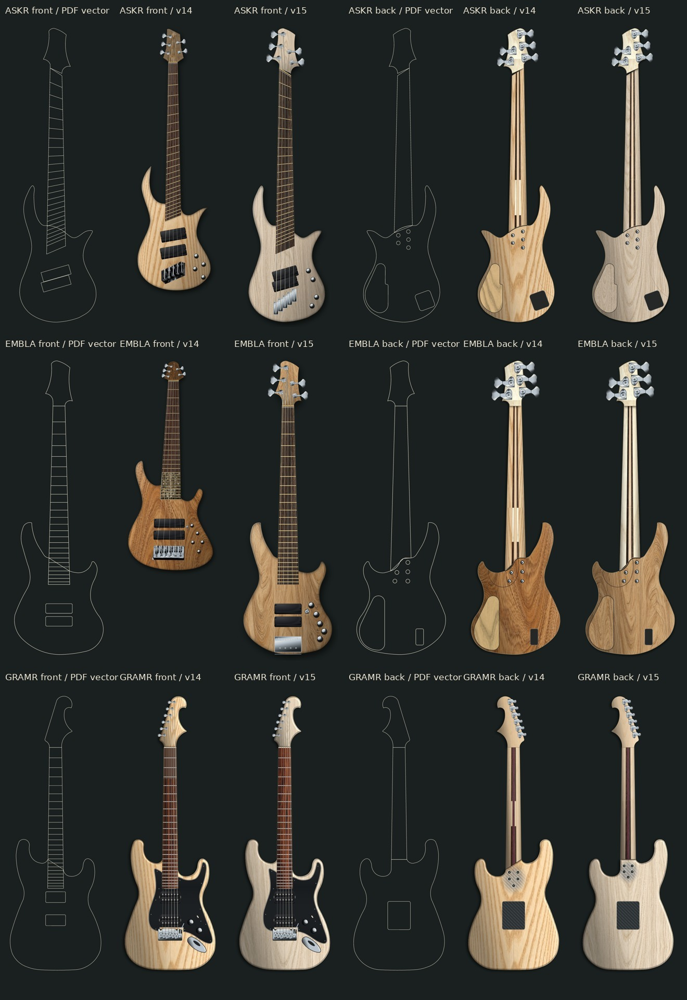
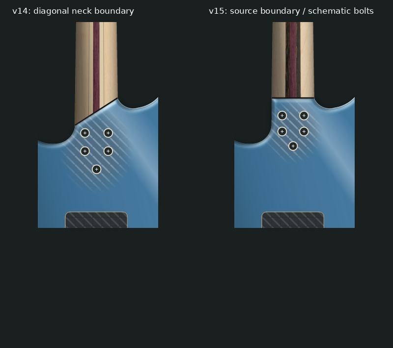
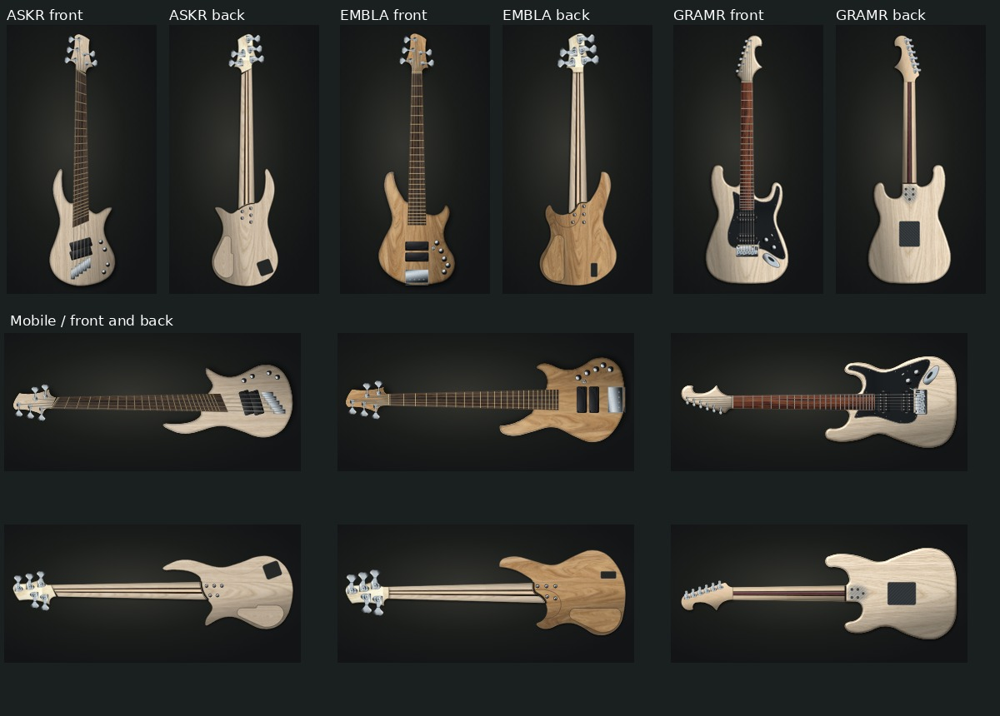

# v15 원본 도면 대조 기록

2026-10-20 KST. 비교 기준은 요청에 기재된 v11 이후 변경을 포함한 PR #35의
v14 `5dfc1f07e54639e11ff41fe13a014405cf77485e`입니다. 기존 production
`configurator.html`, 옵션 데이터, 가격·정규화·견적·PDF 계산은 변경하지 않았습니다.

## 확인 자료

| 모델 | 원본 PDF | SHA-256 |
|---|---|---|
| ASKR #001 | RavenForge_ASKR_MS5001_john0-Model(1).pdf | `94962ee6ea46a1d87c35910537aea98d13adfd9a2ea47c372ae1cbc9b89b6fc5` |
| EMBLA #002 | RavenForge_EMBLA_002_LYW_34_5ST-Model.pdf | `b5953882c1c5018d5eede0fa73f8e16dfd113e772de44f0629dd7614e82aaef5` |
| GRAMR | RavenForge_Superstrat_24F_ver3_STRICT_R12-Model(1).pdf | `3edaab849e644ba2c1aa2e28abdbed9c92a246cb7a3ca5591da152d22c609b1d` |

PDF의 벡터 경로를 직접 읽고 페이지 회전·축척을 적용했습니다. 래스터 이미지의
외곽을 추정하거나 AI로 악기 형상을 생성하지 않았습니다. 원본 PDF는 배포하지
않으며, 추출 스크립트는 입력 해시를 검사합니다. 경로 인덱스·변환·연결 오차는
생성된 geometry의 `provenance`에 기록되어 있습니다.

## 발견 사항과 수정

| 부위 | 발견한 차이 | v15 조치 | 검증 경계 |
|---|---|---|---|
| ASKR 전면 | 기존 샘플의 바디/헤드 윤곽, 픽업 각도·앵커, 계산 프렛이 원본과 다름 | PDF의 바디·헤드 곡선, 24개 팬프렛, 5개 튜너·현 앵커 적용 | #001 투영도와의 일치; 교체 부품 장착·가공 승인은 아님 |
| EMBLA 전면 | 샘플 래스터의 윤곽과 부품/튜너 배열이 #002 5현 도면과 다름 | PDF 바디·헤드, 24프렛, 5현 앵커와 원본 5노브 중심 적용 | 3/4/6노브와 추가 스위치는 설치 예시 |
| ASKR·EMBLA 후면 | 도면에서 추출한 외곽·볼트 중심은 유지할 근거가 있음 | 기존 5볼트 중심, 커버·배터리 외곽 유지 | 넥 포켓 깊이·공구 경로·릴리프 단면 미확정 |
| GRAMR 후면 넥 | 넥 끝을 하단 컷어웨이 접점에 연결하여 경계가 비스듬함 | PDF 경로 5613의 횡방향 경계 적용, 바디 연결점 수정 | 경계 투영선만 확인; 현재 힐의 가공 형상은 별도 |
| GRAMR 볼트 | 제공 PDF는 구형 4점 플레이트, 현재 플랫폼은 무플레이트 5볼트 2-2-1 | 현행 구조를 유지하고 경계 부근에 빗금 도식 표시 | 볼트 좌표·딥 테논·최종 힐 형상은 **미승인** |
| 후면 Opaque | ASKR·EMBLA의 불투명 마감에도 목재 텍스처가 적용됨 | 바디와 커버를 단색 도장으로 분리, 독립 명암 유지 | 도장·부품 윤곽은 벡터. 표면 광택은 예시 |
| 픽업 치수 | ASKR 원본의 45TW 외곽을 다른 선택 커버에 그대로 맞출 위험 | 원본 117.5×38 mm 기준에서 선택 부품의 등록 치수로 축척 | 제조사 외형 참고; 라우팅/간섭 미승인 |

확대 검토에서 EMBLA 코일 스위치가 픽업 모서리에 겹치는 것도 수정했습니다.
추가 스위치는 원본 픽업 외곽에서 12 표시 단위 이상 떨어뜨렸으며, 가공 좌표로 승인한 것은 아닙니다.

원본 5노브 중심은 해당 토폴로지에만 사용합니다. 전자장치를 바꾸면 기능에 맞는
3/4/5/6노브 배열과 독립 코일·킬스위치가 유지됩니다. ASKR 고정 브리지 마감,
EDDA 픽가드와 Nova, 바인드룬, 옵션 의존성 및 언어별 견적 기능도 유지합니다.

각 행은 ASKR, EMBLA, GRAMR입니다. 왼쪽 세 칸은 전면, 오른쪽 세 칸은 후면이며
각각 추출 원본 외곽, v14, v15 순서입니다. 표면·교체 부품과 원본 윤곽의 확인
범위를 분리하기 위해 첫 칸은 선 도면으로 표시했습니다. GRAMR 선 도면에
현재 5볼트의 확정 좌표를 추가하지 않았습니다.

## 텍스처와 마감 해상도

기존 1254×1254 아틀라스의 한 셀은 테두리를 제외하면 410×410입니다.
Ash, elm, maple, rosewood, wenge, flame maple, bloodwood, bubinga **8종**을
각각 **724×2172** 독립 원본으로 교체했습니다. 확대 보간 없이 WebP quality 93으로
인코딩했습니다. 원본 대비 가로 1.77배, 세로 5.30배, 픽셀 수 9.35배이며,
종횡비를 보존하므로 바디/지판 비율에 따라 일부 영역이 잘립니다.

**2048×2048 원본 요구는 아직 충족하지 않습니다.** 생성 요청 크기와 실제
출력 크기를 구분했고, 나머지 **21종**은 기존 아틀라스를 유지합니다. 실제 목재
재고 사진이나 수종 감정 자료도 아닙니다. 향후 진짜 2048 이상 독립 촬영/스캔을
받으면 개별 파일과 크기 메타데이터만 교체할 수 있게 경로를 분리했습니다.
`assets/configurator-materials/native-v15.json`에 실제 크기, 원본·WebP 해시,
생성 프롬프트를 기록했습니다.

ASKR·EMBLA·GRAMR의 불투명 바디는 목재 래스터의 해상도에 의존하지 않습니다.
목재 무늬를 숨기되 외곽, 하드웨어, 프렛은 벡터로 유지합니다. EDDA의 원본
샘플과 후면 AI 시안은 기존 참고 등급을 유지합니다.

## 검증 결과

- PASS: 565개 허용 옵션 대입 × KO/EN/DE × 전후면 렌더링 및 production 계산 소스 동일성.
- PASS: 기존 계약 검사, 24프렛·5현·윤곽 연결 오차, Opaque 후면 단색 도장,
  GRAMR 경계/미확정 좌표, 네이티브 텍스처 해시·실제 이미지 크기 8종.
- 실제 Chromium에서 1440×1080 / 390×844의 ASKR·EMBLA·GRAMR 전후면을 확인했습니다.
  모바일은 가로형 전체 악기, 데스크톱은 세로형 전체 악기로 표시하며 가로 넘침이 없습니다.
- 한국어 글꼴을 갖춘 별도 캡처를 사용했습니다. 로컬 검증은 CDN 접속 제한 때문에
  동일 버전 React 18.3.1 / Babel 7.29.2 / html2pdf 0.10.1 / Tailwind 3.4.17의
  실제 라이브러리 바이트를 검증본에 내장했습니다. 앱 상태나 PDF는 모킹하지 않았습니다.
- 24 UI 조합·58 색상/재질 검사·24 PDF 전체 결과는 **해당 커밋의 CI와 PR 설명**에
  기록합니다. 이전 v11/v14 성공 결과를 v15 검증으로 재사용하지 않습니다.
- 이 기록의 검증은 시각 미리보기 범위입니다. 가공 도면이나 제작 승인으로 해석하지 않습니다.

[ASKR 전체 화면](validation/v15/askr-desktop-mobile.jpg) ·
[EMBLA 전체 화면](validation/v15/embla-desktop-mobile.jpg) ·
[GRAMR 전체 화면](validation/v15/gramr-desktop-mobile.jpg)

## 재생성

원본 PDF를 별도 디렉터리에 둔 뒤 `python3 tools/extract_bass_front_geometry.py <dir>`를
실행합니다. GRAMR은 `tools/extract_gramr_preview_geometry.py <pdf>`를 사용합니다.
이 작업은 PDF 입력 해시/경로를 검사하며 가격 데이터는 수정하지 않습니다.
`node tools/test_configurator_preview.cjs`, `node tools/test_configurator_contracts.cjs`로
계약과 렌더링을 검사하고, `.github/workflows/configurator-preview.yml`로 실제
브라우저 및 PDF 매트릭스를 실행합니다. 테스트 ZIP/단일 HTML은 워크플로 아티팩트에
포함됩니다. production 배포·머지는 이 PR 검토 후 별도 승인 대상입니다.
