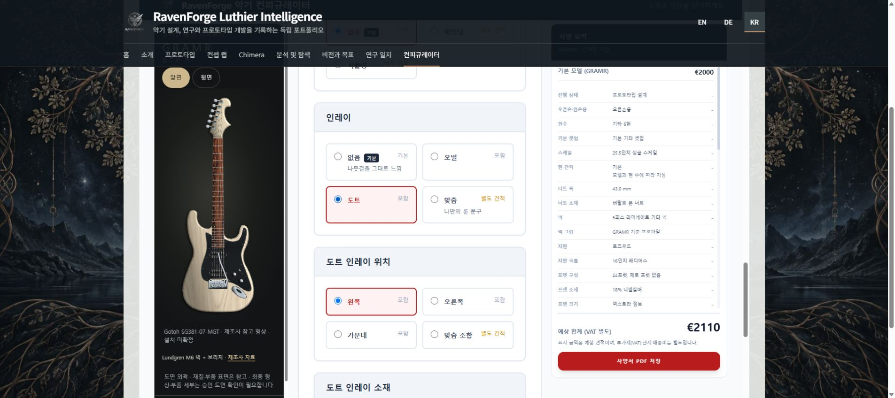

# Homepage quote audit — 2026-10-23

## Scope and source identity

- Public URL: https://raven-deadwire.github.io/RavenForge-Luthier-Intelligence/#configurator
- Deployed source checked: `42bf1d4284b78e4a6c60fe692dc6b9ae26af45a4`.
- PR #50 merge: `10ce577f69c7972767bb33754954ff683b5c3d30`.
- PR #51 merge: `4f2d99526f123c22f574e7a81d70dd8dcaec7981`.
- Pages deployment run: https://github.com/raven-deadwire/RavenForge-Luthier-Intelligence/actions/runs/39913839027 (success).
- Byte comparisons of index.html, ko.html, de.html, configurator.html and the platforms/UI/preview JS modules all matched. SHA-256 evidence is in `configurator-quote-deployment-2026-10-23.json`. This is not a claim that every binary asset was compared.
- Interactive observations below used the actual public homepage iframe in connected Chrome. Model cards, radios, checkboxes, text fields and homepage language buttons were operated through their UI.

## Live results

| Model | Default price | Dot selected from a fresh model | Representative language-switch configuration | Amount retained in KO/EN/DE |
|---|---:|---|---|---:|
| EDDA | €2,100 | Black/white, +€0 | Dot; passive; dual tone +€100; xPure +€100; premium gigbag +€200; leather strap +€300 | €2,800 total |
| EMBLA | €2,550 | Black/white, +€0 | Dot; Noll +€250; premium gigbag +€200 | €3,000 total |
| ASKR | €3,200 | Black/white, +€0 | Dot; Darkglass +€165; automatic Nova Custom pickup fallback (on request); premium gigbag +€200 | €3,565 priced-items subtotal |
| GRAMR | €2,000 | **FAIL: abalone selected automatically, +€110** | Explicit free black/white dot; passive guitar electronics (on request); dual tone +€100; premium gigbag +€200 | €2,300 priced-items subtotal |

The ASKR and GRAMR subtotals exclude separately quoted items and are not final instrument prices. GRAMR's current Zuta option is explicitly planned/power-unconfirmed; the UI transition test is not hardware certification.

- EDDA: passive extras increased €2,100 → €2,300; NFP removed them and showed €2,440; returning to passive showed €2,100 with both boxes unchecked. Explicit reselection restored €2,300.
- GRAMR (explicit free dot): passive + dual tone showed €2,100 subtotal; Zuta showed €2,000 with the extra absent; returning to passive showed €2,000 subtotal with dual tone unchecked; explicit reselection added €100.
- EMBLA and ASKR have no selectable passive EQ in the current catalog. The audit verified supported active EQ transitions and absence of passive-only extras; it did not fabricate a passive path.
- For all four models, the homepage KO → EN → DE → KO round trip retained model, selected options, custom hex colour, multilingual notes (`드롭 A`, `Öl finish`) and price/subtotal. Summary labels and power-supply descriptions changed language.
- Choosing paid abalone explicitly is legitimate. The defect is its automatic selection when choosing included dots on a fresh GRAMR configuration.

## Fix and regression coverage

PR: https://github.com/raven-deadwire/RavenForge-Luthier-Intelligence/pull/55

The production change is one line in `assets/configurator-platforms.js`: pass `dot_bw` to the existing `shareGuitarOptions` standard-material argument. No duplicate pricing logic, price changes, model resets or catalog expansion are introduced. Both configurator pages consume this shared module.

- Added all-model normalization contracts for free default dots and explicit €110 paid abalone. The new GRAMR assertion fails on the deployed implementation and passes with the fix.
- Existing 577-option preview contracts pass after the fix.
- Extended the existing browser/PDF harness with `--homepage`. It covers every model's free/paid dot behavior, supported EQ transitions, passive-extra clearing/reselection, all five steps' form state, custom colour, notes, totals, unchanged iframe source and document time origin, and KO/DE/EN round trips.
- The same real PDF observer compares every summary row and amount against PDF input; twelve actual PDF files per target are downloaded. The existing PDF raster/OCR checker accepts an explicit expected count of 12 (its default remains 24).
- The PDF checker now renders sequentially. Two local threaded rechecks produced truncated PNG evidence; a sequential recheck of the same 24 PDFs passed. PyMuPDF's [documented lack of thread support](https://pymupdf.readthedocs.io/en/latest/recipes-multiprocessing.html) makes sequential execution the safe minimal correction. PDF content/amount assertions are unchanged.
- CI runs candidate and public-site audits separately. A live-site failure is informational for the PR and remains recorded as a failure; it cannot satisfy the candidate gate. PDF raster checks and artifacts run even after an assertion failure.

## Execution status

### Prior CI PDFs with identical configurator source

Actual artifact `12483577020` from successful run [39910361574](https://github.com/raven-deadwire/RavenForge-Luthier-Intelligence/actions/runs/39910361574) was downloaded and inspected. Its source `107da49500596c83b6fe172ee570b243cf35e448` has no differences from deployed `42bf1d42` in configurator.html, platforms/UI/preview JS or configurator CSS. This is **CI output from a local HTTP server**, not PDFs downloaded from the public homepage in this audit.

The 24 actual PDFs cover four models × three languages × desktop/mobile, totaling 40 A4 pages. Their summary-source comparisons and raster/OCR checks passed in the original run, with no browser runtime errors. All page contact sheets and representative Korean/German pages were visually inspected in this audit; localized headings and special characters render, and no clipped/overlapping quote rows were observed. Several exports put the total on a second page; that is a layout characteristic, not a blank-page failure.

| Model | KO | EN | DE | Interpretation |
|---|---:|---:|---:|---|
| EDDA | €2,600 | €2,600 | €2,600 | Priced-items subtotal; request-only guard items excluded |
| EMBLA | €3,150 | €3,150 | €3,150 | Estimated total |
| ASKR | €3,480 | €3,480 | €3,480 | Estimated total; includes -€70 Nova replacement adjustment |
| GRAMR | €2,350 | €2,350 | €2,350 | Priced-items subtotal; request-only guard items excluded |

These configurations differ from the manual live combinations in the table above. They do not cover the new GRAMR dot default regression or prove a public-homepage PDF round trip.

An independent local rerender/OCR recheck of these 24 files also passed for all 40 pages using sequential rendering.

### New homepage run

Code contracts and syntax checks have passed. Browser/PDF workflow execution is pending at this report revision:
https://github.com/raven-deadwire/RavenForge-Luthier-Intelligence/actions/runs/39918497486

The final report/test-stability commit triggers a new run; its current execution is listed in [PR #55 checks](https://github.com/raven-deadwire/RavenForge-Luthier-Intelligence/pull/55/checks). Neither queued jobs nor added test definitions count as a browser pass.

Connected-browser PDF download capture timed out, so it is not counted as PDF-content verification. Public-homepage PDF contents and the new candidate's browser behavior remain unverified until the new CI artifacts have been inspected. The production site still contains the GRAMR default-material defect; the PR has not been merged or deployed.
